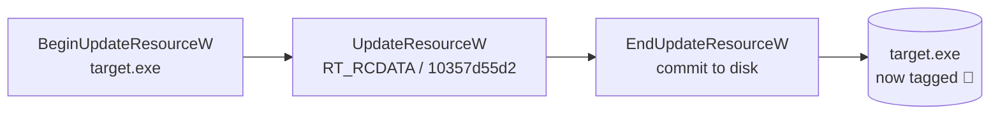
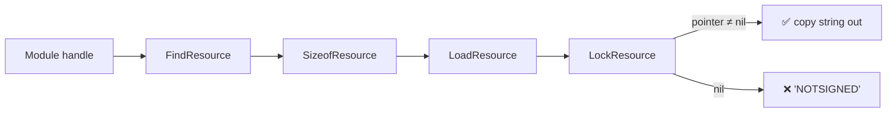
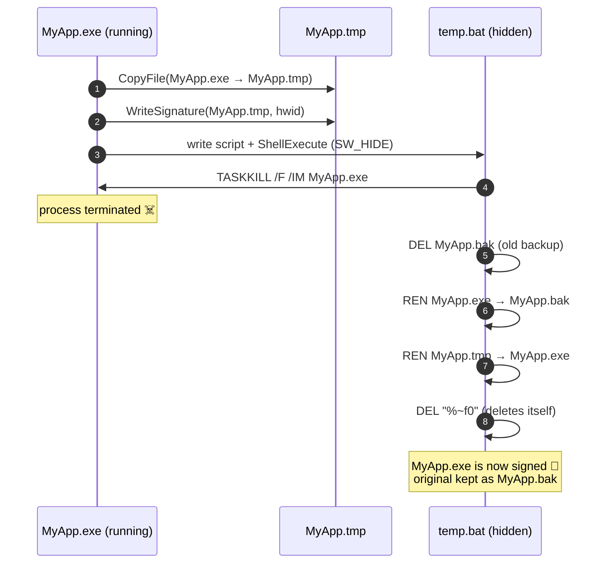

<div align="center">

# 🔏 ExeSign

### Stamp an identity into any Windows executable, right inside its PE resources

*No sidecar files. No registry keys. The tag lives inside the `.exe` itself.*

[](https://www.embarcadero.com/products/delphi)
[](#-requirements)
[](#-how-it-works)
[](LICENSE)

[](ExeSign.pas)
[](#-requirements)
[](https://github.com/rdxdt/ExeSign/stargazers)
[](https://github.com/rdxdt/ExeSign/commits/main)

[How it works](#-how-it-works) •
[API](#-api-reference) •
[Usage](#-usage) •
[Self-signing](#-self-signing-under-the-hood) •
[Caveats](#caveats)

</div>

---

## ✨ Overview

**ExeSign** is a small Delphi unit that writes a string, the *signature*, into a Windows executable as a
PE resource, and reads it back later from another program or from the executable itself.

You can use it to tie a build to a specific identity, for example:

- 🖥️ **Hardware binding**: lock a binary to a machine's HWID
- 🧾 **Licensing**: embed a customer or license ID in a per-customer build
- 🏷️ **Build tagging**: stamp a build number, channel or tenant after compilation
- 🔁 **First-run personalization**: have the app sign *itself* the first time it runs

> [!NOTE]
> "Signature" here means an **identity tag**, not an Authenticode code signature. ExeSign does not
> cryptographically sign anything. See [Caveats](#caveats).

---

## 🧠 How it works

Every Windows executable (PE file) can carry a **resource section** (`.rsrc`) for icons, version info, dialogs,
and arbitrary binary blobs. ExeSign stores its tag there as a raw data resource:

| Property | Value |
| --- | --- |
| Resource type | `RT_RCDATA` (`10`) |
| Resource name | `10357d55d2` |
| Language | `0` (neutral) |
| Payload | UTF-16 string, null-terminated |

```text
 MyApp.exe
 ┌──────────────────────────────┐
 │ DOS / PE headers             │
 ├──────────────────────────────┤
 │ .text   (code)               │
 │ .data   (globals)            │
 ├──────────────────────────────┤
 │ .rsrc   (resources)          │
 │  ├─ RT_ICON                  │
 │  ├─ RT_VERSION               │
 │  └─ RT_RCDATA                │
 │      └─ "10357d55d2"  ◄──────┼── 🔏 "MY-HWID-1234"\0  (UTF-16)
 └──────────────────────────────┘
```

### ✍️ Writing

`WriteSignature` uses the Win32 resource update API:



Windows rewrites the `.rsrc` section and leaves the code alone. Existing resources (icons, version info) are kept.

### 📖 Reading

`LoadSignature` maps the target file with `LoadLibrary` and walks its resource table.
`LoadSelfSignature` does the same with the running module's handle, so nothing extra is loaded:



---

## 📚 API reference

```pascal
const
  EXE_NOT_SIGNED = 'NOTSIGNED';

function  WriteSignature(fName: string; Signature: string): Boolean;
function  LoadSignature(fName: string): string;
function  LoadSelfSignature(SelfHandle: THandle): string;
procedure SelfSign(hwid: string);
function  processExists(exeFileName: string): Boolean;
```

| Routine | What it does | Returns |
| --- | --- | --- |
| `WriteSignature` | Embeds `Signature` into the executable at `fName`. The file must **not** be running. | `True` on success |
| `LoadSignature` | Reads the signature from another executable on disk. | The signature, `EXE_NOT_SIGNED`, or `'Error reading signature:…'` |
| `LoadSelfSignature` | Reads the signature of the running module. Pass `HInstance`. | Same as above |
| `SelfSign` | Signs the **currently running** executable through a copy-and-swap batch script. | — |
| `processExists` | Checks whether a process with the given image name is running (case-insensitive). | `True` / `False` |

---

## 🚀 Usage

### 1. Add the unit

Copy [`ExeSign.pas`](ExeSign.pas) into your project and add it to your `uses` clause:

```pascal
uses
  ExeSign;
```

### 2. Stamp an executable from a separate tool

```pascal
// e.g. in a build/packaging tool
if WriteSignature('C:\Builds\MyApp.exe', 'CUSTOMER-00042') then
  Writeln('Signed ✔')
else
  Writeln('Failed: ', SysErrorMessage(GetLastError));

Writeln('Tag: ', LoadSignature('C:\Builds\MyApp.exe'));  // CUSTOMER-00042
```

### 3. Check the tag at runtime inside the app

```pascal
var
  Sig: string;
begin
  Sig := LoadSelfSignature(HInstance);

  if Sig = EXE_NOT_SIGNED then
    ShowMessage('This copy has not been activated yet.')
  else if Sig <> GetMachineHWID then            // your own HWID routine
  begin
    ShowMessage('This copy is licensed to another machine.');
    Halt(1);
  end;
end;
```

### 4. Let the app sign itself on first run

```pascal
if LoadSelfSignature(HInstance) = EXE_NOT_SIGNED then
  SelfSign(GetMachineHWID);  // the process is terminated and swapped on disk
```

---

## 🔄 Self-signing under the hood

Windows locks an executable's image while it is running, so a process cannot rewrite its own resources.
`SelfSign` gets around this by signing a **copy** and handing the swap to a hidden batch script:



The generated script looks like this:

```bat
TASKKILL /F /IM MyApp.exe
DEL /Q MyApp.bak
REN MyApp.exe MyApp.bak
REN MyApp.tmp MyApp.exe
DEL "%~f0"
```

> [!TIP]
> The app is **not** restarted afterwards. Relaunch it yourself, or add a `START` line to the script.

---

## 🧩 Requirements

| | |
| --- | --- |
| **OS** | Windows (any version with the `UpdateResource` API, i.e. NT-based) |
| **Compiler** | Delphi XE2 or newer (uses the `System.SysUtils` unit scope) |
| **Units** | `Windows`, `ShellApi`, `Classes`, `TLHelp32`, `System.SysUtils`. RTL only, no third-party packages |
| **Strings** | Unicode (`string` = `UnicodeString`), signatures are stored as UTF-16 |

---

<a id="caveats"></a>

## ⚠️ Caveats

- **Not a security boundary.** The tag is plain text in the resource table. Anyone with a resource editor
  (Resource Hacker, etc.) can read or change it. If tampering matters, store a hash or HMAC of the identity
  instead of the raw value.
- **Breaks Authenticode.** Changing resources invalidates any existing code-signing signature. Stamp first, then
  code-sign.
- **`SelfSign` uses `TASKKILL /IM`**, which kills **every** process with the same image name, not only the
  current one.
- **Write access required.** The executable's folder must be writable (no `Program Files` without elevation).
- `LoadSelfSignature` calls `FreeLibrary` on the handle you pass. With the `HInstance` of an `.exe` this is generally
  harmless, but don't pass a handle you still need to keep loaded.

---

## 📄 License

Distributed under the **MIT License**. See [`LICENSE`](LICENSE) for details.

<div align="center">

Made with ☕ and Object Pascal by [**@rdxdt**](https://github.com/rdxdt)

</div>
